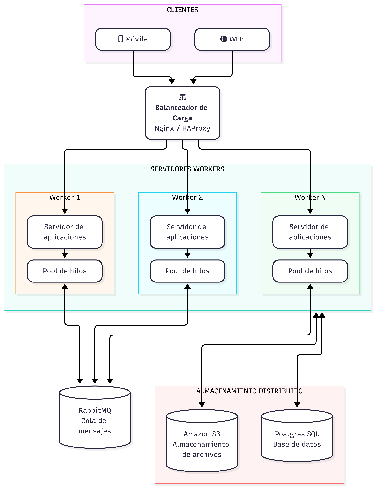

# PFO 3: Sistema Distribuido de Gestión de Tareas con Sockets

Sistema de gestión de tareas con una arquitectura cliente-servidor distribuida. El servidor que recibe tareas por socket TCP, las distribuye entre un pool de workers (hilos) y devuelve los resultados a cada cliente.

El registro e inicio de sesión de usuarios con contraseñas hasheadas con bcrypt y la base SQLite.

## Tecnologías

- Python 3
- `socket` (comunicación TCP)
- `threading` (un hilo por cliente y un pool de workers)
- `queue` (cola de tareas compartida)
- `json` (formato de los mensajes)
- SQLite (módulo `sqlite3`)
- bcrypt (hash de contraseñas)

## Estructura del proyecto

```
pfo3/
├── servidor.py        # Servidor de tareas con pool de workers
├── cliente.py         # Cliente de consola que envía tareas y recibe resultados
├── DIAGRAMA.md        # Diagrama de arquitectura del sistema distribuido
├── diagrama.png       # Diagrama exportado como imagen
├── requirements.txt
├── .gitignore
└── README.md
```

## Funcionamiento

```
Cliente 1 ──┐                         ┌──> worker-1 ──┐
Cliente 2 ──┼──> Servidor ──> Cola ───┼──> worker-2 ──┼──> resultado al cliente que la envió
Cliente N ──┘   (1 hilo por cliente)  └──> worker-N ──┘
                                              │
                                           SQLite
```

1. El servidor escucha en `127.0.0.1:5001` y atiende a cada cliente en su propio hilo.
2. Cada pedido recibido se coloca en una cola compartida (`queue.Queue`).
3. Un pool de workers (4 por defecto, `CANTIDAD_WORKERS`) toma los pedidos de la cola y los procesa en paralelo.
4. Cada worker envía el resultado directamente al cliente que originó el pedido. Un lock por conexión evita que se mezclen mensajes cuando varios workers responden al mismo cliente.
5. El cliente recibe las respuestas en un hilo aparte. Como pueden llegar en distinto orden, cada pedido lleva un `id` para saber a cuál corresponde cada respuesta.
6. Al iniciar sesión el servidor devuelve un `token`. Como cualquier worker puede atender cualquier pedido, el usuario se identifica con ese token y no con la conexión.

## Instalación y ejecución

1. Clonar el repositorio:

   ```bash
   git clone https://github.com/adco23/PSR-PFO3.git
   cd PSR-PFO2-gestion-tareas
   ```

2. Crear y activar un entorno virtual e instalar las dependencias:

   ```bash
   python -m venv venv
   venv\Scripts\activate
   pip install -r requirements.txt
   ```

3. Iniciar el servidor:

   ```bash
   python servidor.py
   ```

4. En otra terminal, iniciar el cliente (se pueden abrir varios a la vez):

   ```bash
   python cliente.py
   ```

   ```
   --- Cliente de tareas (sockets) ---
   1. Registrarse
   2. Iniciar sesión
   3. Crear tarea
   4. Ver tareas
   5. Completar tarea
   6. Eliminar tarea
   7. Generar reportes en paralelo
   8. Cerrar sesión
   9. Salir
   ```

## Protocolo

Cada mensaje es un objeto JSON en una línea, terminado en `\n`.

Pedido:

```json
{"id": 3, "tipo": "crear_tarea", "token": "9f2c...", "datos": {"titulo": "Estudiar", "descripcion": "Sockets"}}
```

Respuesta correcta:

```json
{"estado": "ok", "mensaje": "Tarea creada", "tarea_id": 1, "id": 3, "worker": "worker-2"}
```

Respuesta con error:

```json
{"estado": "error", "error": "No autenticado", "id": 3, "worker": "worker-2"}
```

## Tipos de tareas

| Tipo | `datos` | Requiere token | Resultado |
|---|---|---|---|
| `registro` | `usuario`, `contraseña` | No | Crea el usuario |
| `login` | `usuario`, `contraseña` | No | Devuelve el `token` de sesión |
| `logout` | - | Sí | Invalida el token |
| `crear_tarea` | `titulo`, `descripcion` (opcional) | Sí | `tarea_id` de la tarea creada |
| `listar_tareas` | - | Sí | Lista de `tareas` del usuario |
| `completar_tarea` | `tarea_id` | Sí | Marca la tarea como completada |
| `eliminar_tarea` | `tarea_id` | Sí | Elimina la tarea |
| `generar_reporte` | - | Sí | Resumen de tareas (simula un proceso lento de 2 s) |

Si el JSON es inválido, el tipo no existe o los datos no son correctos, el servidor responde con `"estado": "error"` sin cortar la conexión.

## Cómo probar el paralelismo

Iniciar sesión y elegir la opción **7. Generar reportes en paralelo** indicando, por ejemplo, 4 reportes. Cada reporte tarda 2 segundos. En la consola del servidor se ve que cada uno lo toma un worker distinto, y en el cliente los 4 resultados llegan a los ~2 segundos en lugar de a los 8:

```
4 reportes enviados, esperando resultados...
  [ 2.0s | worker-2] total=1 completadas=1 pendientes=0
  [ 2.0s | worker-4] total=1 completadas=1 pendientes=0
  [ 2.0s | worker-1] total=1 completadas=1 pendientes=0
  [ 2.0s | worker-3] total=1 completadas=1 pendientes=0
Tiempo total: 2.0s
```

## Diagrama de arquitectura

El diagrama del sistema distribuido (clientes, balanceador de carga, workers, cola de mensajes y almacenamiento) está en [DIAGRAMA.md](DIAGRAMA.md).



En la implementación, cada parte del diagrama tiene su equivalente local:

| Diagrama | Implementación |
|---|---|
| Clientes móviles / web | `cliente.py` (se pueden abrir varios) |
| Servidor de aplicaciones | Hilo que atiende cada conexión en `servidor.py` |
| Pool de hilos de cada worker | Hilos `worker-1` ... `worker-N` |
| Cola de mensajes (RabbitMQ) | `queue.Queue` compartida |
| Almacenamiento (PostgreSQL) | SQLite (`tareas.db`) |

## Autora

Adriana Coronel
